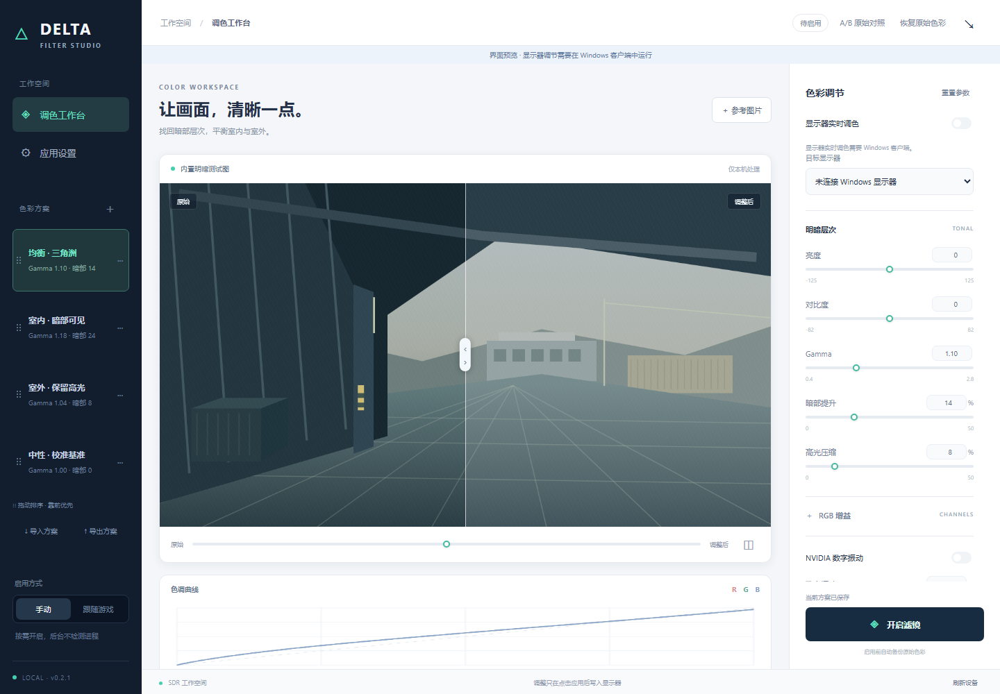
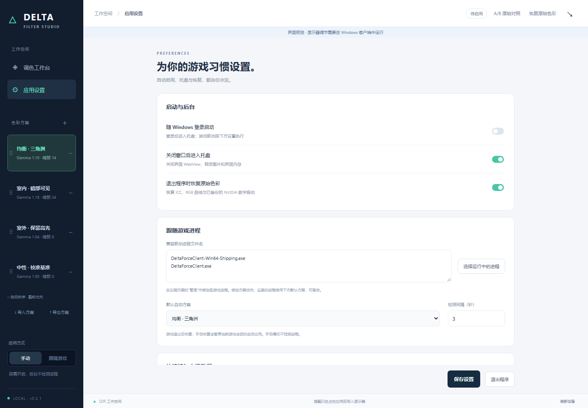
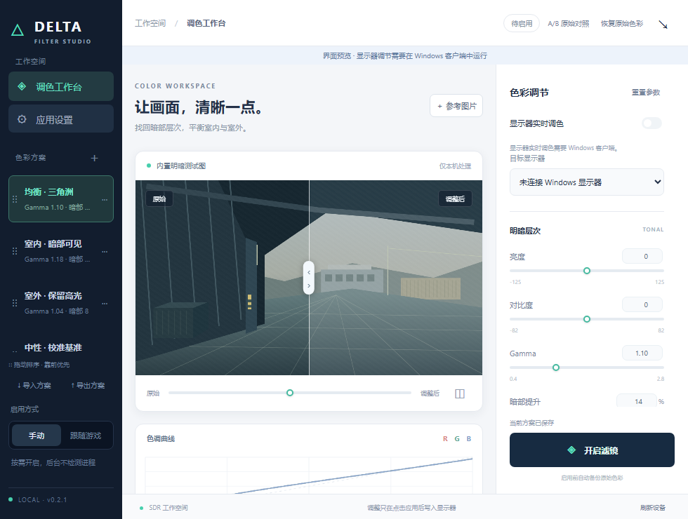

# DeltaForce Filter Manager

面向《三角洲行动》的 Windows 显示器色彩调试工具。**HTML / CSS / TypeScript 界面 + Rust / Tauri 2 后台**，用本机参考图片对照暗部、中间调、高光与 RGB，支持 ICC、NVIDIA 数字振动、手动开启、游戏进程联动和托盘。

**[下载最新版客户端](https://github.com/CodeWriter-Jay/DeltaForceFilterManager/releases/latest)**

- **安装版**：下载 `win-x64-setup.exe`，安装器在缺少 WebView2 时安装共享运行时。
- **便携版**：下载 `win-x64-portable.zip`，解压到固定目录，运行 `DeltaForceFilterManager.exe`。
- **单文件客户端**：下载 `win-x64.exe` 直接运行；需要本机已有 WebView2。建议固定文件名/目录后再设置自启。

支持 Windows 10/11 x64、SDR。便携版和单文件 EXE 使用系统 **Microsoft Edge WebView2**，不捆绑 Chromium、完整 WebView2 或 .NET。客户端下载在 Release 的 **Assets** 中；Actions 中的 artifact 是构建验证包。

## 程序截图

以下截图对应最新正式版，由该版本的界面验证流程生成（浏览器预览）。每次成功发布 Release 后自动同步。

调色工作台：参考图片、RGB 曲线、显示器实时调色开关与方案管理。



应用设置：登录启动、托盘、退出恢复和默认游戏进程联动。



紧凑布局：适合较小窗口的工作台。



## 功能与使用

| 功能 | 行为 |
| --- | --- |
| ICC 管理 | 扫描系统与本机导入目录，导入/导出 `.icc` / `.icm`，切换 WCS 当前用户默认配置 |
| 显示器调色 | 亮度 −125…125、对比度 −82…82、Gamma 0.4…2.8、RGB 增益 −100…100 |
| 实时调色 | Windows 默认启用，拖动参数直接写入显示器；首次写入前备份，后续只更新必要组件，后台有限复查；保存方案独立于显示器应用 |
| 明暗调节 | 暗部提升、高光压缩；内置均衡、室内、室外、中性起始方案 |
| NVIDIA 数字振动 | 可选 0…100%，匹配具体显示器，使用驱动真实范围，写后回读 |
| 参考图片 | 选择/拖入 PNG、JPEG、BMP，最大 25 MB / 3200 万像素；本机处理，不上传；箭头键/鼠标移动分隔线 |
| 方案管理 | 保存、另存、重命名、删除、JSON 导入/导出；左侧拖动排序，也可聚焦 ⋮⋮ 后按 ↑ / ↓；切换前处理未保存草稿 |
| 手动 / 游戏联动 | 每个方案可绑定多个进程；多个方案同时匹配时按左侧顺序选择；手动模式不查询进程，全部匹配进程退出后恢复 |
| 自启 / 托盘 | 设置中独立开关随登录进入托盘、关闭到托盘、退出时恢复；托盘打开/开关/恢复/退出 |
| 软件更新 | 设置中检查 GitHub 最新正式 Release，下载单文件 EXE 并校验 SHA256，备份方案、恢复显示器后原地替换并重启；启动验证失败回滚旧 EXE |
| 事务与恢复 | 首次修改前持久化 ICC、Gamma 和可用的 NVIDIA 原始状态；失败回滚；异常退出下次启动恢复 |
| 多显示器 | 按显示器身份定位；恢复前不允许更换调节目标；断开时保留备份 |
| 快捷键 | `Ctrl+Shift+F10` 开关、`Ctrl+Shift+F11` 恢复；冲突会显示错误 |

1. 选择显示器与起始方案，导入一张包含室内暗部与室外亮部的游戏截图。
2. 默认开启 **显示器实时调色**，调整 Gamma、暗部、RGB 和可选数字振动时，显示器直接变化。参考图显示显示器实际效果，不再额外叠加图片滤镜。关闭实时调色可保留手动应用方式；未启用显示器滤镜时仍可使用图片分屏预览。
3. 用 **A/B 原始对照** 比较实际显示器效果；对照或恢复会暂停实时跟随，重新开启开关或点击应用可继续。点击 **保存方案** 保留参数，实时写入不会自动覆盖已保存方案。实时模式或启用状态下切换已保存方案会立即应用。
4. 如需不同游戏自动使用不同方案，点击左侧方案的 **···**，填写绑定进程或通过 **选择运行中的进程** 确认真实游戏进程，保存后切换 **跟随游戏**。此处也可重命名、删除方案；拖动 **⋮⋮** 调整排序。
5. 需要开机启动时，在设置中开启 **随 Windows 登录启动** 并保存。更换 EXE 名称/目录后重新保存此项。

绑定只填写 `.exe` 文件名（不区分大小写），每个方案最多 16 个；任一绑定进程运行即可触发，清空绑定会解除关联。多个方案同时匹配时，左侧排序靠前的方案优先；当前游戏退出而其他游戏仍在运行时，自动切换到下一个匹配方案，全部匹配进程退出后恢复原始色彩。

保留旧版全局联动设置：设置中的 **兼容联动进程文件名** 默认仍为 `DeltaForceClient-Win64-Shipping.exe`、`DeltaForceClient.exe`，没有方案绑定匹配时使用 **默认自动方案**，也可清空这些进程名，只使用方案绑定。检测间隔默认 3 秒。自动模式中手动恢复会暂停本次会话的自动应用，直到全部匹配进程退出；自动启用后手动更新仍保留游戏退出时恢复的行为。关闭跟随模式会恢复由自动模式启用的滤镜。删除正在应用的方案前需先恢复，至少保留一个方案。

## 运行说明

ICC 的色彩描述与校准曲线不同：有 `vcgt` 时与调整 LUT 叠加，没有时仍关联系统 ICC，但游戏 LUT 使用中性基准；非色彩管理游戏通常不使用 ICC 的矩阵/色域转换。调色基准始终来自启用前备份，方案切换不会累积曲线。高光压缩不能恢复游戏渲染时已裁剪的细节。

亮度、对比度、Gamma 和 RGB 调节使用 Windows Gamma Ramp。NVIDIA 数字振动需要显示器由 NVIDIA 显卡直接输出且驱动提供 DVC 扩展接口；不可用时其余调色功能仍可使用。应用会在启用前备份原始色彩，写入后回读并复查，失败时恢复。

Windows 显示切换、独占全屏、休眠、插拔、夜间模式或其他校色软件可能重置色彩曲线，遇到此情况可重新应用方案。开启 HDR/高级色彩时停止 SDR 应用或恢复。克隆显示器共享 GDI source，无法独立调节。

滤镜作用于整个目标显示器，包括本应用；图片分屏用于相对对照，不能精确模拟面板、ICC 色域转换或 NVIDIA 数字振动。导入 ICC 后首次系统安装可能受权限限制；遇到错误可先在 Windows 色彩管理中安装，应用不会静默提权。恢复原始默认配置不会卸载已安装的文件或删除导入关联。

关闭到托盘时销毁 WebView 窗口，释放界面和图片缓存；再打开时重新创建窗口，保留当前草稿和本次选中的参考图片路径。图片内容不写入设置。

应用不注入游戏或读取游戏内存。

## 设置与恢复

设置和恢复备份保存在 `%LOCALAPPDATA%\DeltaForceFilterManager\`。保持 v0.1.0 的 JSON 格式（PascalCase、SchemaVersion 1），方案可选的 `ProcessNames` 字段记录绑定进程，`Profiles` 数组顺序保存排序；旧配置没有此字段时按未绑定处理。兼容旧版自动写出的 `SelectedProfile` / `GameProfile` 计算属性，新版按方案 ID 读取，不再重复保存这些对象。跨电脑导入后重新选择本机 ICC，并检查进程名。未完成的旧备份在启动时优先恢复。

**v0.2.0 升级可保留方案。** 已核对该版本源码，使用同一数据目录；单文件 EXE 不把方案保存在程序旁边。`settings.json` 保存方案与设置，`icc\` 保存导入的 ICC，`recovery.json` 保存尚未完成恢复的原始显示器备份。同一 Windows 用户替换、重命名或移动 EXE 后仍读取此目录；重命名/移动后需要重新保存自启设置。`LiveAdjust` 新字段在旧配置中缺省时启用实时模式，原方案 ID、颜色参数、ICC 路径保持不变。

软件内更新位于 **应用设置 → 版本与更新**。仅点击检查/升级时连接本项目 GitHub Release；下载读取 GitHub 提供的 SHA256 摘要，校验后保留当前 EXE 路径并原地升级，因此自启路径不变。安装版和便携版都沿用同一数据目录；当前 EXE 所在目录必须可写，无法写入时会停止升级并报告错误。

升级不会删除或重置方案与 ICC。退出前强制恢复原始色彩，并生成 `settings.before-update-<ID>.json`；旧 EXE 保留为原程序目录下的 `.delta-force-previous-<ID>.exe`。新程序未在 30 秒内通过启动与配置读取检查时回滚旧 EXE。v0.2.0 本身没有内部更新按钮，第一次需手动下载新版替换；之后可在软件内升级。恢复旧方案备份前请先关闭应用，保留当前 `settings.json`，再用备份替换它。

损坏文件不会自动重置或覆盖。恢复失败会保留备份，可在重新连接原显示器或关闭 HDR 后重试。关闭“退出时恢复”后仍保留备份，下次启动会恢复。紧急恢复在程序未运行时执行：

```powershell
.\DeltaForceFilterManager.exe --restore
```

## 开发与验证

需要 Node.js 22.12+、Rust stable；Windows 构建需要 MSVC C++ 工具和 WebView2。使用 lockfile 固定依赖。

```powershell
npm ci
cargo test --workspace --locked
cargo fmt --all -- --check
cargo clippy --workspace --locked -- -D warnings
npm run build
npx playwright install chromium
npm run test:web
npm run tauri -- dev
npm run tauri -- build --target x86_64-pc-windows-msvc
```

便携 EXE：`target/x86_64-pc-windows-msvc/release/delta-force-filter-manager.exe`；安装版：相邻 `bundle/nsis/`。macOS 可测试核心和预览 HTML，但硬件调节只在 Windows 实现。浏览器运行 `npm run dev` 会明确标注界面预览，不执行系统调色。

GitHub Actions 验证 Rust 核心/控制器、HTML 交互、方案切换、参考图片与原生 WebView IPC，并生成完整/紧凑/设置截图及进程树空闲报告。仓库维护者手动运行工作流、勾选 `publish_release` 后，验证通过会发布带 EXE、ZIP、安装包、SHA256 校验和的普通 Release，并设为 latest。发布成功后，独立任务会将该构建的三张截图同步到默认分支的 `docs/screenshots/`，自动提交 README 引用的图片；同步失败可单独重跑，不会重复发布客户端。

```text
crates/filter-core/   参数、曲线、ICC、图片边界、事务、WCS/GDI/NVAPI、自启与进程
src-tauri/           Rust 控制器、HTML IPC、托盘、快捷键与窗口生命周期
web/                 本地 HTML/CSS/TypeScript 工作台
scripts/             图标源、Windows 原生验证与进程树资源采样
tests/web/           HTML 交互与视觉验证
```

MIT License。
